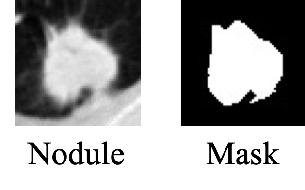
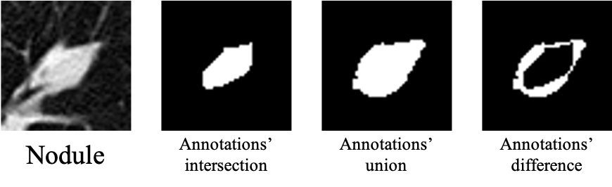

# LIDC-IDRI Toolbox (Python)

Personal toolbox for the [LIDC-IDRI](https://wiki.cancerimagingarchive.net/display/Public/LIDC-IDRI) dataset — lung cancer / pulmonary nodule analysis.

This project is a personal toolbox, but it can really help to get information from LIDC-IDRI.
I am willing to make it better with your help.

For the label information, you can refer to [Shen S , Han S X , Aberle D R , et al. An Interpretable Deep Hierarchical Semantic Convolutional Neural Network for Lung Nodule Malignancy Classification[J]. 2018.](<https://arxiv.org/abs/1806.00712>).

## Repository structure

```
LIDC-IDRI-Toolbox-python/
├── codeForLIDC/                  # LIDC-IDRI 主流程
│   ├── get_PatientId_SeriesUID.py
│   ├── get_scan_xml.py
│   ├── orignize_list_nodule_chara.py
│   ├── get_dicom_info.py
│   ├── get_single_dicom.py
│   ├── csvTools.py               # CSV 读写工具
│   ├── OriImage.py / dataprepare.py / divide_nodule.py / counting.py / transpose.py
│   └── files/                    # 预生成的元数据（malignancy.csv / id_scan.txt 等）
└── CodeForMulitpleAnnotations/   # 多标注处理（MICCAI 2022 论文）
    ├── xmlopt.py                 # 从 XML 提取标注边缘
    ├── get_data.py               # 生成结节多标注的交/并/差
    ├── get_second_mask.py
    └── csvTools.py
```

## Requirements

The code was written around 2018 and relies on legacy APIs (`scipy.misc`, early `pydicom`). **It is recommended to install it in a Python 3.7 / 3.8 virtual environment** with the pinned versions in `requirements.txt`:

```bash
python -m venv venv
source venv/bin/activate        # Windows: venv\Scripts\activate
pip install -r requirements.txt
```

Key legacy-API notes:

| Dependency | Note |
|---|---|
| `scipy` | must be `<1.3` — `scipy.misc.imresize/imsave/imread` were removed in scipy 1.3.0 |
| `pydicom` | must be `<2.0` — the code uses the 1.x API (`pydicom.read_file`, `PixelData` handling) |
| `numpy` / `pandas` | 1.x-era versions, see `requirements.txt` |
| `opencv-python`, `Pillow`, `imageio`, `matplotlib`, `scikit-learn`, `tqdm`, `xlrd` | `xlrd` is needed to read the `.xls` files in `codeForLIDC/files/` |

## Usage

### Key code in `codeForLIDC`

#### *get_PatientId_SeriesUID.py*
It gives out the *id_scan.txt*, which can help to load CT files according to patient Id.

#### *get_scan_xml.py*
It gets nodule's id and its nine features from the xml files and gives out *nodule_chara_list.csv*.

#### *orignize_list_nodule_chara.py*
It gives out the *malignancy.csv*, which combines the *nodule_chara_list.csv* and the *list3.2.csv*. With *malignancy.csv*, you can get all information about labeled nodules.

#### *get_dicom_info.py*
It can get nodules' images and labels with *malignancy.csv* and *id_scan.txt*.
By running this code, you can have nodule images and their masks (single mask).

If you only want to get the data, you can run the code:
```python
noduleinfo = csvTools.readCSV('files/malignancy.csv')
idscaninfo = csvTools.readCSV('files/id_scan.txt')
```
Then use pydicom to process the DICOM files. I save the relationships between case id and dicom path in the 'malignancy.csv', and 'id_scan.txt', which can be found in 'LIDC-IDRI-Toolbox-python/codeForLIDC/files/'.



### `CodeForMulitpleAnnotations`

Get nodules with multiple segmentation annotations.
The method has been used in [Wang, Qiuli, et al. "Uncertainty-Aware Lung Nodule Segmentation with Multiple Annotations." arXiv preprint arXiv:2110.12372 (2021)](https://arxiv.org/abs/2110.12372). You can get the processed data here: https://pan.baidu.com/s/1nQLaS_NEaiBeGOeHxHV1dg, Code: 4f38

#### *xmlopt.py*
It can extract label edges from xml files.

#### *get_data.py*
By running `python get_data.py` in `CodeForMulitpleAnnotations`, you can have nodule images and their multiple annotations' intersection, union, and difference.



## Citation

If you find it helpful to your research, please cite as follows:
```bibtex
@inproceedings
{yang2022uncertainty,
 title={Uncertainty-Guided Lung Nodule Segmentation with Feature-Aware Attention},
 author={Yang, Han and Shen, Lu and Zhang, Mengke and Wang, Qiuli},
 booktitle={Medical Image Computing and Computer Assisted Intervention--MICCAI 2022: 25th International Conference, Singapore, September 18--22, 2022,    Proceedings, Part V},
 pages={44--54},
 year={2022},
 organization={Springer}
}

@inproceedings{wang2020class,
  title={Class-aware multi-window adversarial lung nodule synthesis conditioned on semantic features},
  author={Wang, Qiuli and Zhang, Xingpeng and Chen, Wei and Wang, Kun and Zhang, Xiaohong},
  booktitle={Medical Image Computing and Computer Assisted Intervention--MICCAI 2020: 23rd International Conference, Lima, Peru, October 4--8, 2020, Proceedings, Part VI 23},
  pages={589--598},
  year={2020},
  organization={Springer}
}
```

## License

MIT License — see [LICENSE](LICENSE).

---

Feel free to contact me (qiuli.wang0102@foxmail.com) if you have any problems.
